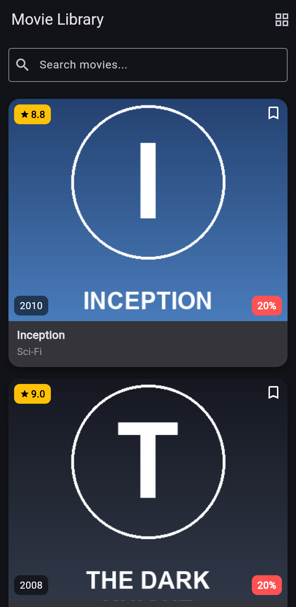
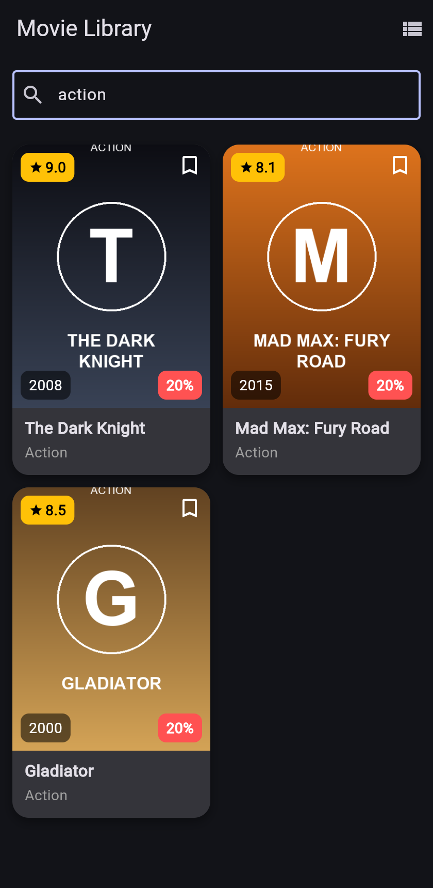
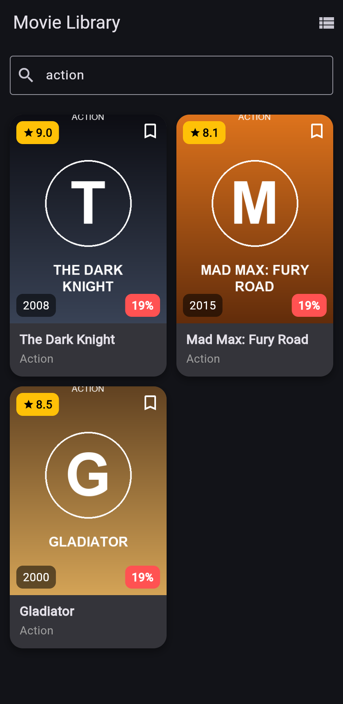

# Movie Library – Flutter (Section 3 task)

**Live demo:** https://mohamedahmed2059.github.io/flutter-movie-library-app/

A Flutter app that shows a collection of movies. You can search by title or genre and switch between a list layout and a grid layout.

| List view | Grid view + search ("action") |
|---|---|
|  |  |

| Bonus: tap the discount once, every card changes | No results |
|---|---|
|  |  |

## What's inside
- **Data model (`movie.dart`):** a `Movie` class with final `title`, `genre`, `year`, `rating` and `image` fields, a const constructor with named required parameters, and a `movies` list with 10 movies.
- **Local images:** a poster for every movie in `assets/posters/`, registered in `pubspec.yaml` and shown with `Image.asset()`.
- **`MovieCard` (`movie_card.dart`, StatelessWidget):**
  - A `Container` with a `BoxDecoration` that has rounded corners, a shadow, a background color taken from the theme, and `clipBehavior` so the poster follows the rounded corners.
  - A `Stack` over the poster with `Positioned` items: the rating badge (top-left), a bookmark icon (top-right) and the year (bottom-left).
  - The title (bold) and the genre (grey) under the image.
- **`HomePage` (`home_page.dart`, StatefulWidget):**
  - An AppBar with "Movie Library".
  - A search `TextField`.
  - `ListView.builder` (one movie per row) or `GridView.builder` with 2 columns (`SliverGridDelegateWithFixedCrossAxisCount`).
  - An `IconButton` in the AppBar switches between list and grid using a `bool` and `setState`.
- **Search without a controller:**
  - `onChanged` saves the text with `setState`.
  - The list is filtered with `.where()` and `.toList()` on the title or the genre, case-insensitive.
  - "No movies found" shows when nothing matches.
  - The field has the hint "Search movies..." and a search icon.

### Bonus: one tap, all cards change
Every card shows the same discount badge (starting at 20%). Tapping it on **any** card makes **all** cards go down by one (19%, 18%, …).
- The value is stored in `HomePage`'s State, because HomePage is the parent that builds every card.
- `MovieCard` stays a StatelessWidget: it receives the value and a `VoidCallback`, and calls the callback on tap.
- HomePage runs `setState`, and every card rebuilds with the new value. No state management package is used.

## Project structure
```
lib/
  main.dart        -> MaterialApp + theme
  home_page.dart   -> HomePage (Stateful)
  movie_card.dart  -> MovieCard (Stateless)
  movie.dart       -> Movie class + movies list
assets/posters/    -> movie images
```

## Run it
```bash
flutter pub get
flutter run
```
